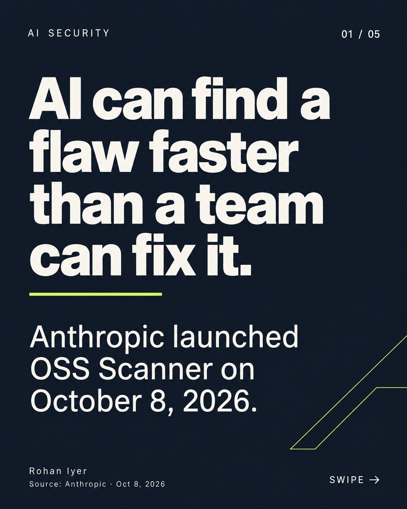

# LinkedIn AI News Carousel Agent

A portable agent skill and reference workflow for turning **verified AI developments no older than four days** into humanized, fact-checked, ImageGen-created LinkedIn PDF documents or 3–5-image posts, delivered through Publora.

Built by Rohan Iyer. This repository documents a working content and media preparation workflow plus reusable local verification scripts. It is **not a one-command autonomous publisher**: your agent host supplies web research, image generation, scheduling, authentication and Publora tools. Codex preparation and media were tested; Claude and Hermes setup is documented, not live-tested. Confirmed LinkedIn publication and real analytics are separate milestones.



## What it does

- Discovers live AI changes from public forums and verifies original announcements, papers and releases.
- Prefers the past 72 hours and rejects events older than 96 hours; no seven-day fallback.
- Separates writer, humanizer and reviewer roles without inventing personal experience or performance numbers.
- Generates each carousel slide with an image-generation tool, then checks exact copy, labels and topic continuity.
- Supports an ordered PDF document or 3–5-image post, chosen for the news theme.
- Creates a Publora draft by default; autonomous publishing requires explicit account-specific authorization.
- Records pending submissions before writes and reconciles uncertain outcomes before retrying.
- Learns from available observed analytics rather than promising viral reach.

## Quick start

```bash
git clone https://github.com/roronoa2003/linkedin-ai-news-carousel-agent.git
cd linkedin-ai-news-carousel-agent
python3 -m venv .venv
. .venv/bin/activate
python -m pip install -r requirements.txt
python -m unittest discover -s tests -v
python scripts/verify_carousel.py examples/oss-scanner/manifest.json
```

An optional GitHub Actions definition is supplied in `examples/ci-workflow.yml`; CI is not enabled automatically.

Open [the example PDF](examples/oss-scanner/oss-scanner-linkedin.pdf). Its order is announcement → offering → limitation → implication → closing question. This October 8, 2026 example is historical test material. It **must not be reused as fresh news** on later dates.

Install/read [the skill](skills/linkedin-ai-news-carousel/SKILL.md), copy `config.example.json` to `config.local.json`, and configure your own identity and authorization. Ask your agent:

> Read skills/linkedin-ai-news-carousel/SKILL.md and config.local.json. Run a dry run using live AI developments from the past 72 hours, maximum 96 hours. Verify primary sources, draft and humanize the caption and slide copy, generate each slide, build and verify the ordered PDF. Save the artifacts. Create a Publora draft only; do not schedule or publish.

Start in draft mode. Validate your own account connection, image tool and document upload. Then decide whether to authorize routine publishing and create the host's schedule. Installing this repository alone does not authorize any public post.

## Guides

| Guide | Contents |
|---|---|
| [Architecture](docs/architecture.md) | Stages, artifacts, agents and responsibilities |
| [Setup and compatibility](docs/setup.md) | Codex, Claude Code/Desktop, Hermes, other agents |
| [Live research](docs/discovery.md) | Forum discovery, freshness and source verification |
| [Carousel design](docs/carousels.md) | Exact copy, visual continuity, numbering and PDF order |
| [Publora](docs/publora.md) | Draft creation, document upload, publishing reconciliation |
| [Scheduling](docs/scheduling.md) | Host-specific scheduling and failure handling |
| [Humanizer and reach](docs/quality-and-analytics.md) | Writing tests, hashtags, metrics and limits |
| [Troubleshooting](docs/troubleshooting.md) | Upload, freshness, image and duplicate issues |
| [Evidence](docs/verification.md) | Tested behavior and untested integrations |
| [Sources and credits](docs/sources.md) | Official documentation and design references |

## Repository layout

```text
skills/linkedin-ai-news-carousel/  Portable SKILL.md + reference workflow
scripts/                         Freshness and ordered PDF helpers
examples/oss-scanner/             Five generated slides, PDF, prompts, manifest
examples/domain-map.json          180 AI domain ideas; never a fixed queue
config.example.json              Identity/brand/authorization template
AGENTS.md / CLAUDE.md             Host entry instructions
run-prompt.md                    Portable scheduled-run prompt
runtime/                        Local run data (gitignored)
```

## Requirements and portability

Python 3.10+ runs the helper scripts. Web browsing, image generation, Publora MCP/REST and scheduling come from the host. Codex's built-in ImageGen is not automatically available in Claude or Hermes; those hosts need an explicitly configured image-generation tool/API. Read [setup](docs/setup.md) for the capability matrix. A host missing a required capability retains a draft and reports the limitation.

## Publishing and privacy

Keep tokens, OAuth state, private voice samples, runtime ledgers and account-specific IDs outside the public repository. The included example contains public attribution and public news. Do not commit your populated config. Do not disable tool approval or upload restrictions to make an integration work. No DMs, connection requests or comments are part of this workflow.

MIT licensed original code/instructions. Referenced third-party skills are credited and not vendored. Image examples are demonstration assets, not an Anthropic endorsement. No reach guarantee or AI-detector certification is offered.

Latest media policy: choose a theme-specific template each run; use either a 5–7-page PDF or 3–5 images, selected by story suitability and format history. Images can display as a grid. Verify manifest/visible numbering and attachment order. Read docs/carousels.md for adaptive templates, relevant mentions/hashtags, comment-review boundaries and controller-security research lens.

## Consistent slides, fresh designs

Each post now uses a frozen design lock and an inspected master ImageGen slide as the reference for every remaining slide. Font family, role-based type sizes, weight, spacing, palette and layout stay consistent inside that post; the next story gets a theme suited to its subject. See [the full ImageGen procedure and repository references](skills/linkedin-ai-news-carousel/references/imagegen-consistency.md) and [design-lock example](examples/design-lock.json). A visual review is required because generative images cannot guarantee exact font metrics.

[Discovery](docs/discovery.md) uses current community leads, original release evidence, event/version deduplication and claim-level sourcing. Every post must still pass the 96-hour gate after generation. These are orchestration requirements; unattended image quality and live publishing have not been established by configuration checks alone.

## Practical personal notes

Posts now connect fresh releases to a concrete project or an existing company workflow, with a small implementation sketch and a measurable pilot. They distinguish a new stack from an update and vary the first-person editorial structure before humanization. See [the writing contract](skills/linkedin-ai-news-carousel/references/practical-notes.md).
