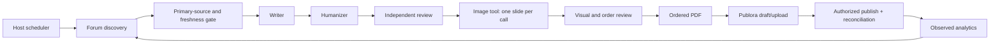

# Architecture

The system is an agent workflow with small deterministic helpers, not a proprietary model or a background service installed by this repository.

## Host responsibilities

The host provides a browser/search connector, filesystem, image generation, publishing connection and scheduler. The skill supplies decisions and procedure. Python helpers enforce age and PDF ordering. Tool permissions and user authorization remain host responsibilities. The same SKILL.md is usable across platforms but tool wiring is not interchangeable.

## Role boundaries

Writer receives a verified event brief; humanizer edits prose; reviewer checks evidence, freshness and media copy. The parent manages files, reconciliation and writes. With no subagent support use separate sequential passes and report that distinction. The procedure supports a single user's account; team advocacy and outreach are outside scope.

## State and observability

Every run leaves evidence even when skipped. Preserve candidates and rejection reasons, generated-file hashes, review verdict, actual upload status and external post IDs. Keep runtime data local. Configuration and successful media generation do not establish live delivery. If a connector returns an ambiguous response, mark unknown and inspect platform state before another write. This design reduces duplicates but is not a transactional exactly-once guarantee across external services.
